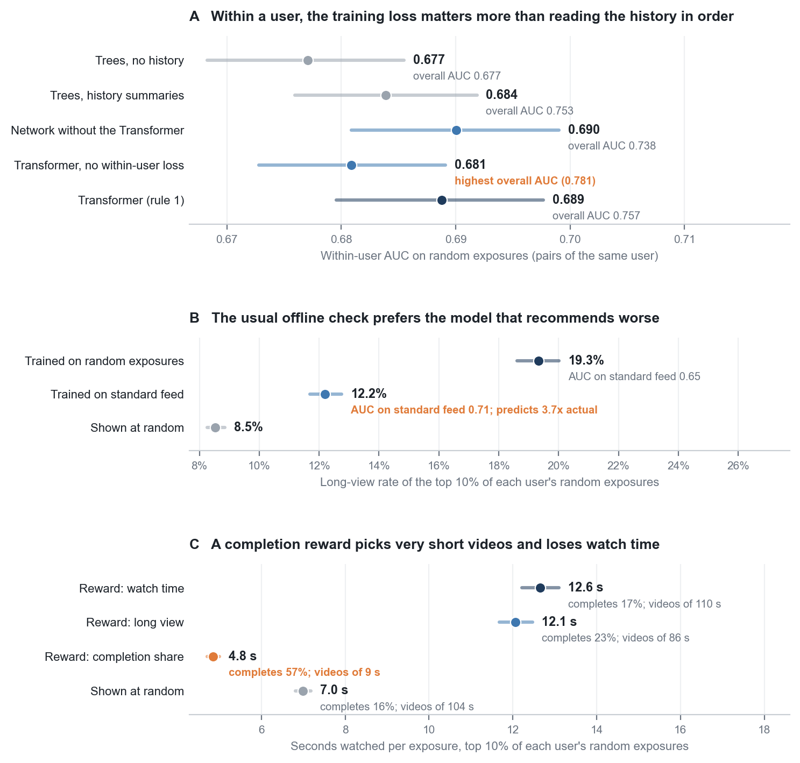

# Feed ranking: what to learn from, how to score it, what to reward

> **Takeaway.** On 369,177 random exposures of 8,644 held-out users, the logs a ranker learns from and the outcome
> it is rewarded for changed what it shows far more than the model did. The same network trained on the standard
> feed scores better on the standard feed (AUC 0.71 against 0.65), yet the videos it ranks highest are long-viewed
> 12.2% of the time against 19.3% when it is trained on random exposures, and it predicts 3.7 times the actual rate.
> Rewarding the share of a video watched makes it pick videos of 9 seconds that are finished 57% of the time and
> watched for 4.8 seconds, 2.2 seconds less than videos shown at random; rewarding watch time gives 12.6 seconds.
> Among models trained on random exposures, a Transformer over the user's last 50 events ranks a user's candidates
> slightly better than gradient-boosted trees (within-user AUC 0.689 against 0.684), but the same network without the
> sequence does as well (0.690): the gain comes from the training loss, not from reading the history in order. All
> three pre-specified rules were met.



**Figure 1.** *Notes:* Every number is computed on the main-feed random exposures of the 8,644 test users who have
any, with 95% intervals from 500 bootstrap draws of users. Panel A shows the share of pairs of the same user's exposures (one long-viewed, one
not) that each model orders correctly, and each model's AUC over all exposures. Panels B and C show, for each user,
the exposures in the top 10% of the user's random exposures by a model's score, and the mean outcome over them. Navy
marks the result the study stands behind, grey a simple baseline, blue other models and orange a number that misleads.

## Question

A short-video feed ranks candidate videos for each user. Three choices decide whether that ranking serves users: the
model that predicts a user's response, the logs it is trained and scored on, and the outcome it is rewarded for.
Each choice has a version that looks right on the usual offline numbers and is wrong when checked against users'
behaviour on videos the recommender did not choose. This repository makes that check, using a release in which a
share of recommendations was replaced by videos drawn at random.

## Data

**KuaiRand-Pure** (Gao et al. 2022), released on Zenodo under CC BY 4.0: logs of 27,285 users of the Kuaishou app from 8 April
to 8 May 2022 on a pool of 7,583 videos, with twelve feedback signals per exposure. From 22 April, recommendations were
replaced at random by a video drawn uniformly from the pool: 1,186,059 such exposures, about 160 per video. The data
are not in this repository; download `KuaiRand-Pure.tar.gz` from [Zenodo](https://zenodo.org/records/10439422) and pass
the path of its `data/` folder.

| Log | Exposures | Users | Long view | Seconds watched |
|---|---|---|---|---|
| Standard feed, 8–21 April | 1,141,112 | 26,210 | 33.7% | 23.3 |
| Standard feed, 22 April–8 May | 295,497 | 25,877 | 31.3% | 21.5 |
| Random exposures, 22 April–8 May | 1,186,059 | 27,285 | 8.5% | 6.9 |

A **long view** is a play of at least 18 seconds, or of the whole video if it is shorter. The gap between the two kinds
of log is the selection the recommender makes: videos the feed chose are watched four times as often.

## Design

The analysis plan, [`design/analysis_plan.md`](design/analysis_plan.md), was fixed before any model was run on the
final users (SHA-256 in [`logs/plan_hash.txt`](logs/plan_hash.txt)). The settings and the three thresholds were
chosen on the **pilot users** (user ids divisible by five; 5,457 users), whose scripts, log and results are kept in
[`pilot/`](pilot) and [`out/pilot/results.json`](out/pilot/results.json).

- **Final users.** The other 21,828 users, split by user: train 50% (10,914), validation 10% (2,182), test 40% (8,732, of whom 8,644 have random
  exposures in the main feed).
- **Examples.** Exposures in the main feed, where 99% of random exposures happen: 470,538 random and 419,032 standard
  exposures of the train users. The history of an exposure is the same user's earlier events of either kind; at the
  test exposures it has a median of 86 events.
- **Why random exposures are the yardstick.** A user's random exposures are a uniform draw from the pool, so ranking
  them and reading the outcomes of the top-ranked ones estimates what a policy that shows the user its top-ranked
  candidates would obtain, with no model of how the feed chose videos. Standard-feed exposures are chosen by the feed,
  so a model scored on them is scored on the feed's choices.
- **Two measures.** *Within-user AUC*: the share of pairs of the same user's exposures, one long-viewed and one not,
  that a score orders correctly; it ignores which users watch more, which a ranker cannot change. *Policy value*: for
  each user, the top 10% of the user's random exposures by score (at least one), and the mean outcome over them.
- **Models.** LightGBM without history and with history summaries (counts and rates of the user's earlier events,
  overall and in the candidate's category). A PyTorch network with embeddings of the video, its category and length,
  the user's features and the same history summaries, plus a two-layer Transformer encoder over the last 50 events,
  each with what the user did on it, and the candidate as the last token. It is trained on the label's loss plus a
  pairwise logistic loss over pairs of the same user; three seeds, the epoch with the lowest validation loss kept,
  predictions averaged.

## 1. Which model ranks a user's candidates best?

| Model, trained on random exposures, label long view | Overall AUC | Within-user AUC (95% CI) | Long view, top 10% |
|---|---|---|---|
| LightGBM, no history | 0.677 | 0.677 (0.668 to 0.685) | 19.2% |
| LightGBM, history summaries | 0.753 | 0.684 (0.676 to 0.692) | 18.7% |
| Network without the Transformer | 0.738 | 0.690 (0.681 to 0.699) | 19.5% |
| Transformer, label loss only | **0.781** | 0.681 (0.673 to 0.689) | 18.2% |
| **Transformer with the within-user loss** | 0.757 | **0.689 (0.680 to 0.698)** | 19.3% |

- **Rule 1 was met.** The Transformer orders a user's candidates better than LightGBM with history summaries: +0.0049
  (0.0027 to 0.0071).
- **The order of the history adds nothing here.** The same network without the Transformer is slightly better
  (difference −0.0013, −0.0024 to −0.0002). Histories in this release contain only the 7,583 pool videos, so a user's
  recent viewing outside the pool is missing.
- **The training loss matters more.** Without the within-user loss the Transformer has the highest overall AUC (0.781)
  and a lower within-user AUC (−0.0079, −0.0097 to −0.0063): it learns which users watch a lot, which is most of what
  overall AUC rewards and none of what a ranker can use.
- **The policies differ little.** The long-view rate of each model's top picks ranges from 18.2% to 19.5%, against 8.5%
  for videos shown at random. Which model is used moves the result by about a point; the next two choices move it by
  much more.

## 2. Which logs should the ranker learn from?

The Transformer of section 1 against the same network trained on the train users' standard-feed exposures, the logs
a team normally has.

| | Trained on random exposures | Trained on the standard feed |
|---|---|---|
| AUC on the standard feed's test exposures (the usual offline check) | 0.655 | **0.713** |
| AUC on random exposures | **0.757** | 0.679 |
| Within-user AUC on random exposures | **0.689** | 0.571 |
| Mean prediction over actual long-view rate, random exposures | 1.03 | 3.73 |
| Long view, top 10% (95% CI) | **19.3% (18.6% to 20.0%)** | 12.2% (11.7% to 12.8%) |
| Seconds watched, top 10% (95% CI) | **12.1 (11.7 to 12.5)** | 8.4 (8.1 to 8.7) |

- **Rule 2 was met.** Trained on random exposures, the ranker's top picks are long-viewed 7.1 points more often
  (6.7 to 7.6) and watched 3.7 seconds longer (3.4 to 4.0).
- **The usual check points the other way.** Scored on held-out standard-feed exposures, the model trained on the
  standard feed wins by 0.06 of AUC. It has learned which of the feed's own choices users watch, not which videos a
  user would watch among those the feed did not choose, and it predicts 3.7 times the long-view rate of a random
  video. A team choosing between the two on its usual offline metric would ship the worse ranker.

## 3. Which outcome should it be rewarded for?

The same network trained on random exposures with three labels: the share of the video watched (capped at one), long
view, and the log of seconds watched. Each row is the top 10% of each user's random exposures by that model.

| Reward | Seconds watched | Long view | Share of the video watched | Video length, seconds | Likes per 1,000 |
|---|---|---|---|---|---|
| Share of the video watched | 4.8 | 10.7% | **57%** | 9 | 7.1 |
| Long view | 12.1 | **19.3%** | 23% | 86 | 6.4 |
| **Seconds watched** | **12.6** | 16.9% | 17% | 110 | 6.2 |
| Shown at random | 7.0 | 8.5% | 16% | 104 | 4.9 |

- **Rule 3 was met.** Rewarded for seconds watched, the ranker's picks are watched 7.8 seconds longer than when it is
  rewarded for the share watched (7.4 to 8.2).
- **The share-watched reward is gamed by video length.** It raises the share watched from 16% to 57% by picking videos
  of about 9 seconds, which are easy to finish and short to watch: 2.2 seconds less than a random video (2.0 to 2.3).
  The metric it optimizes rises; the time users spend falls.
- **Rewards trade off.** The watch-time reward gives the most seconds and fewer long views than the long-view reward
  (16.9% against 19.3%); neither dominates. Likes and dislikes are rare (about 6 and 1 per 1,000) and move little.

## What this cannot show

- **A deployed feed.** The policy value is that of choosing among a user's randomly exposed candidates one exposure at a
  time. In a feed, exposures interact and the candidates come from the recommender.
- **Later behaviour.** The outcomes are per exposure. The release keeps only pool videos, so the rest of a session and
  later visits cannot be followed, and the study says nothing about long-run engagement or retention.
- **The value of sequences in general.** The Transformer reads histories restricted to the pool. A release with full
  histories could give a different answer.
- **Other apps and periods.** One app, one month in 2022, 7,583 videos.

## Reproduce

```bash
pip install -r requirements.txt
python steps/s1_baselines.py <KuaiRand-Pure/data> --sample final
python steps/s123_networks.py <KuaiRand-Pure/data> --sample final
python steps/s_summary.py <KuaiRand-Pure/data> --sample final
python steps/s_figures.py --sample final
pytest -q
```

`--sample pilot` runs the same steps on the pilot users. Tested with Python 3.13 on macOS (Apple M3 Ultra, PyTorch MPS);
the networks take about 30 minutes on the final users.

```
design/        analysis plan, hashed before the run on the final users
pilot/         the exploratory scripts and log that chose the settings
src/kr/        data preparation, the network, unbiased evaluation
steps/         one script per stage; results in out/<sample>/results.json
figures/       the main figure
tests/         unit tests (no data needed)
```

## Reference

Gao, Chongming, Shijun Li, Yuan Zhang, Jiawei Chen, Biao Li, Wenqiang Lei, Peng Jiang, and Xiangnan He. 2022.
"KuaiRand: An Unbiased Sequential Recommendation Dataset with Randomly Exposed Videos." In *Proceedings of the 31st ACM
International Conference on Information and Knowledge Management*, 3953–57. https://doi.org/10.1145/3511808.3557624.
